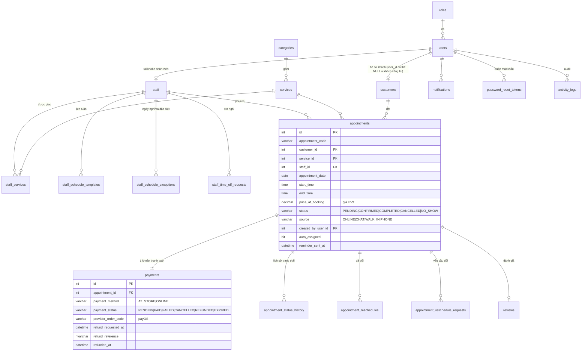
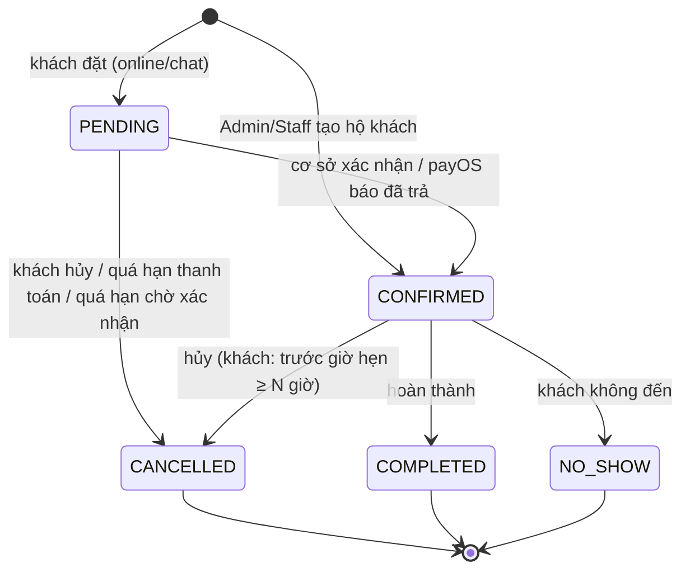

# Sơ đồ quan hệ thực thể (ERD)



## Vòng đời lịch hẹn


## Luồng đặt lịch + thanh toán online
```mermaid
sequenceDiagram
  participant K as Khách
  participant W as Web (React)
  participant S as Server (Express)
  participant D as SQL Server
  participant P as payOS
  K->>W: chọn dịch vụ, nhân viên (hoặc "Bất kỳ"), ngày, giờ
  W->>S: GET /appointments/booking-options
  S->>D: lịch hiệu lực + lịch đã đặt
  S-->>W: khung giờ trống
  W->>S: POST /appointments
  S->>D: BEGIN SERIALIZABLE; kiểm tra chồng lấn; INSERT lịch + payment
  alt trùng giờ
    S-->>W: 409
  else thành công
    S-->>W: 201 (PENDING)
    opt thanh toán online
      W->>S: POST /payments/:id/payos
      S->>P: tạo link thanh toán
      P-->>S: webhook (chữ ký HMAC)
      S->>D: xác minh chữ ký + số tiền; PAID → lịch CONFIRMED
    end
  end
```
